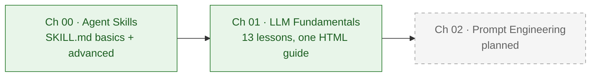
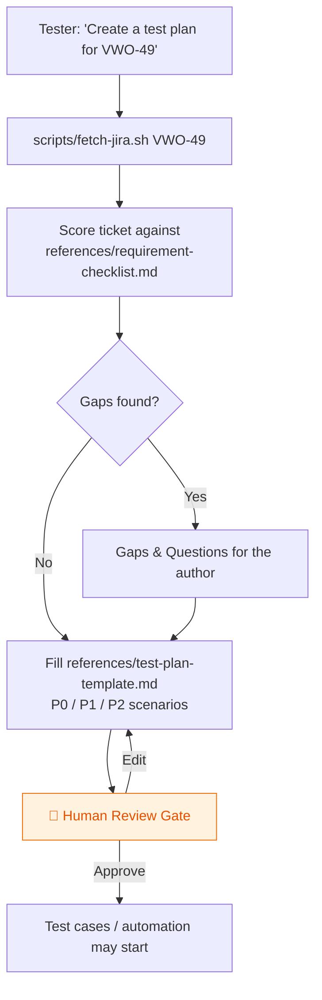
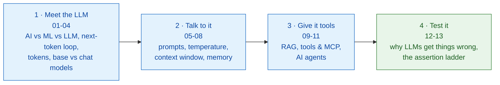

# 🤖 AI Tester Blueprint 5x

Hands-on course material from **The Testing Academy** for testers moving into AI: build Agent Skills that do real QA work, then learn how the LLMs behind them actually behave, so you can test them.

---

## 📑 Table of Contents

- [Roadmap](#-roadmap)
- [Chapters at a glance](#-chapters-at-a-glance)
- [Project structure](#-project-structure)
- [Getting started](#-getting-started)
- [Chapters](#-chapters)
  - [00 · Agent Skill Basics](#00--agent-skill-basics)
  - [01 · LLM Fundamentals from Scratch](#01--llm-fundamentals-from-scratch)
- [Learnings](#-learnings)

---

## 🗺️ Roadmap



---

## 📚 Chapters at a glance

| # | Chapter | What you build or learn | Format | Status |
|:-:|:--------|:------------------------|:-------|:------:|
| 00 | [Agent Skill Basics](Chapter_00_SKILL_Basics/) | A basic and an advanced test-plan skill (Jira ticket -> reviewed test plan) | `SKILL.md` + references + scripts | ✅ |
| 01 | [LLM Fundamentals from Scratch](Chapter_01_LLM_Basics/) | 13 plain-words lessons: tokens, temperature, context, RAG, MCP, agents, testing LLM output | Single-file HTML guide | ✅ |
| 02 | Prompt Engineering | Coming next | | ⏳ |

---

## 🌳 Project structure

```
AITesterBlueprint5x/
├── Chapter_00_SKILL_Basics/
│   ├── 00_basics_skills/
│   │   ├── testplan-creator-skill/          # basic skill: template inline in SKILL.md
│   │   ├── testcase-creator-skill/          # placeholder (empty SKILL.md)
│   │   └── apitestcase-response-validator-skill/   # placeholder (empty SKILL.md)
│   ├── 01_advance-skills/
│   │   └── testplan-creator-skill_a/        # advanced skill: Jira -> gap analysis -> plan
│   │       ├── SKILL.md
│   │       ├── references/                  # requirement-checklist.md, test-plan-template.md
│   │       ├── scripts/fetch-jira.sh        # curl + jq Jira REST v3 fetch
│   │       ├── misc/                        # company logo, company details
│   │       └── output/VWO-49-test-plan.pdf  # sample output
│   └── resources/VWO-49.doc                 # source ticket
├── Chapter_01_LLM_Basics/
│   └── LLM_Fundamentals.html                # 13-lesson guide, open in any browser
├── learnings/                               # one-page approach notes per solved problem
├── output/                                  # generated test plans (HTML + PDF)
└── .env                                     # Jira credentials, git-ignored
```

---

## 🚀 Getting started

```bash
git clone https://github.com/PramodDutta/AITesterBlueprint5x.git
cd AITesterBlueprint5x

# Chapter 01: no build step, just open the guide
open Chapter_01_LLM_Basics/LLM_Fundamentals.html

# Chapter 00: the advanced skill needs Jira credentials in .env (never commit it)
cat > .env <<'EOF'
JIRA_BASE_URL=https://yourco.atlassian.net
JIRA_EMAIL=you@yourco.com
JIRA_TOKEN=your-api-token
EOF
```

---

## 📖 Chapters

### 00 · Agent Skill Basics

**Concept:** An Agent Skill is a folder with a `SKILL.md` file (YAML frontmatter plus instructions) that teaches an AI agent one repeatable QA job. Here, that job is turning a PRD or a Jira ticket into a test plan that follows your company's template.

**Why:** It stops you re-pasting the same long prompt every time: the agent loads your template, checklist and scripts only when the task matches the skill's description.

**Q&A: why use this?**
- **Q: When do I reach for a skill?** A: When you repeat the same QA task (a test plan from a ticket, test cases from a story) and want the agent to follow your template every time without being re-told.
- **Q: What does it replace?** A: A long copy-pasted prompt. The `description` field is the trigger, and the body, `references/` and `scripts/` are loaded only when the skill fires.
- **Q: What's the gotcha?** A: The agent follows the files on disk, so every path named in `SKILL.md` must really exist (check with `ls`), and the human review gate must stay: the skill drafts, a person approves.



**Basic vs advanced skill**

| | `00_basics_skills/testplan-creator-skill` | `01_advance-skills/testplan-creator-skill_a` |
|:--|:--|:--|
| Input | PRD or requirement text | Jira key (`VWO-49`) or pasted ticket |
| Files | One `SKILL.md`, template inline | `SKILL.md` + `references/` + `scripts/` + `misc/` |
| Gap analysis | No | Yes, every checklist row marked ✅ / ⚠️ / ❌ |
| Ends with | A filled test plan | A draft plus a mandatory human review gate |

**Code sample:** the advanced skill's frontmatter, and fetching the ticket the way the skill does.

```yaml
---
name: advance-testplan-creator
description: Turn a JIRA ticket into a review-ready test plan. Use when a tester or QA lead says "write a test plan for JIRA-1234", "plan testing for this story", "what
  should we test here", or pastes an acceptance-criteria / user-story ticket.
license: MIT
metadata:
  stlc-phase: Test Planning
  version: 1.0.0
---
```

```bash
# load Jira credentials from .env, then fetch the ticket as trimmed JSON (needs curl + jq)
set -a; source .env; set +a
bash Chapter_00_SKILL_Basics/01_advance-skills/testplan-creator-skill_a/scripts/fetch-jira.sh VWO-49
# -> { "key": "VWO-49", "summary": ..., "priority": ..., "description": ..., "links": [...] }
```

Sample outputs: [VWO-49-test-plan.pdf](Chapter_00_SKILL_Basics/01_advance-skills/testplan-creator-skill_a/output/VWO-49-test-plan.pdf), [VWO_Login_Dashboard_Test_Plan.pdf](output/VWO_Login_Dashboard_Test_Plan.pdf).

---

### 01 · LLM Fundamentals from Scratch

**Concept:** A 13-lesson, single-file HTML course that explains how LLMs work in plain words, from "what is a token?" to "how a tester checks LLM output". Every lesson reuses one small login feature (rules R1 to R4) and the sentence "The cat will sit on the ___", and ends with a quick check and a practice exercise.

**Why:** AI features fail in new ways (made-up facts, different wording every run, instructions hidden in data) that `expected == actual` assertions miss, and you cannot test what you cannot explain.

**Q&A: why use this?**
- **Q: When do I reach for it?** A: Before your first LLM test. It gives a manual or automation tester the core ideas (tokens, temperature, context window, memory, RAG, MCP, agents) needed to read an AI feature's behaviour, in about an hour.
- **Q: What does it replace?** A: Exact-match thinking. Wording changes every run, so you climb the assertion ladder and assert what must be true: format, rules, meaning, and a judge only for what code cannot check.
- **Q: What's the gotcha?** A: Temperature 0 is not accuracy, it can repeat the same wrong answer every time. And HTTP 200 is not success: a cut-off answer or a refusal also returns 200, so check the stop reason, format, usage and time.



**The assertion ladder (lesson 13):** use the lowest step that can check what matters.

| Step | Use it for | Example check |
|:-----|:-----------|:--------------|
| 1 · Exact match | Labels, IDs, numbers, yes or no | severity is one of High, Medium, Low |
| 2 · Format | Every structured output | The JSON parses and has every required field |
| 3 · Rules | Test cases, plans, bug reports | Each of R1-R4 has a test; no rule outside R1-R4 |
| 4 · Meaning | Free text with a known good answer | Close in meaning to a reviewed answer |
| 5 · Judge | Quality that code cannot check | A rubric graded by another model, checked against human reviewers first |

**Code sample:** the structured prompt from lesson 05. Paste it into any chat model and compare the output against R1 to R4.

```text
Role: You are a senior QA engineer.
Instructions: Write test cases for the login story below.
  [Mandatory] Cover every rule, R1 to R4.
  [Don't] Invent rules that are not in the story.
Context:
  R1: Lock the account after 5 wrong passwords in a row.
  R2: The lock lasts 15 minutes.
  R3: A successful login resets the counter.
  R4: Wrong credentials show a generic error message.
Example: TC-01 | Lock after 5 wrong passwords | enter a wrong password 5 times | the account is locked | R1
Parameters: At most 10 tests. Only facts from the story.
Output: A Markdown table with ID, Title, Steps, Expected, Rule.
Tone: Clear and short.
```

---

## 🧠 Learnings

[learnings/](learnings/) holds one-page notes on how a non-trivial problem was solved: the approach, the judgment calls, and one reusable rule.

| Date | Note |
|:-----|:-----|
| 2026-10-25 | [Jira ticket to review-ready test plan PDF](learnings/2026-10-25-jira-ticket-to-test-plan-pdf.md) |
