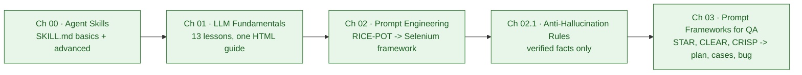
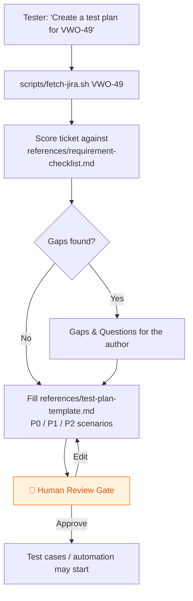
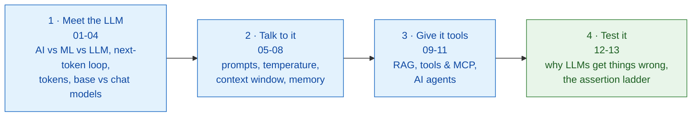
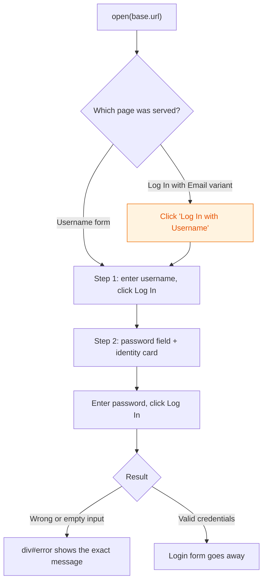
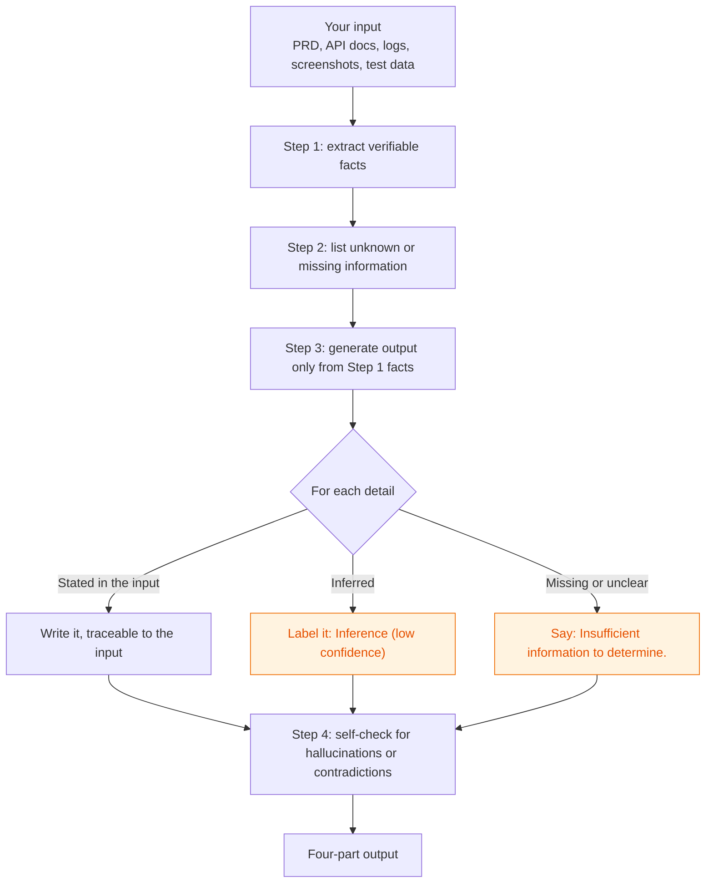
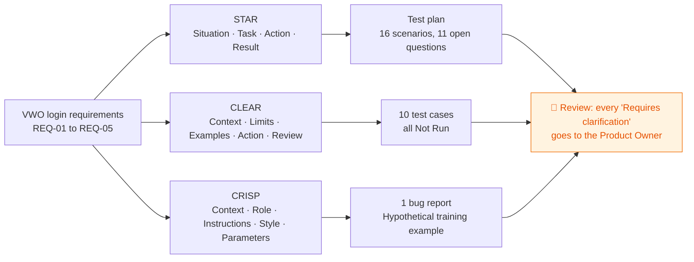

# 🤖 AI Tester Blueprint 5x

Hands-on course material from **The Testing Academy** for testers moving into AI: build Agent Skills that do real QA work, then learn how the LLMs behind them actually behave, so you can test them.

---

## 📑 Table of Contents

- [Roadmap](#-roadmap)
- [Chapters at a glance](#-chapters-at-a-glance)
- [Project structure](#-project-structure)
- [Getting started](#-getting-started)
- [Chapters](#-chapters)
  - [00 · Agent Skill Basics](#00--agent-skill-basics)
  - [01 · LLM Fundamentals from Scratch](#01--llm-fundamentals-from-scratch)
  - [02 · Prompt Engineering: RICE-POT to a Selenium Framework](#02--prompt-engineering-rice-pot-to-a-selenium-framework)
  - [02.1 · Anti-Hallucination Rules](#021--anti-hallucination-rules)
  - [03 · Prompt Frameworks for QA: STAR, CLEAR, CRISP](#03--prompt-frameworks-for-qa-star-clear-crisp)
- [Learnings](#-learnings)

---

## 🗺️ Roadmap



---

## 📚 Chapters at a glance

| # | Chapter | What you build or learn | Format | Status |
|:-:|:--------|:------------------------|:-------|:------:|
| 00 | [Agent Skill Basics](Chapter_00_SKILL_Basics/) | A basic and an advanced test-plan skill (Jira ticket -> reviewed test plan) | `SKILL.md` + references + scripts | ✅ |
| 01 | [LLM Fundamentals from Scratch](Chapter_01_LLM_Basics/) | 13 plain-words lessons: tokens, temperature, context, RAG, MCP, agents, testing LLM output | Single-file HTML guide | ✅ |
| 02 | [Prompt Engineering](Chapter_02_Prompt_Engineering/RICE_POT/) | A RICE-POT prompt turned into a Selenium + Java framework for the Salesforce login page, run headless and headed | Maven + TestNG + Allure | ✅ |
| 02.1 | [Anti-Hallucination Rules](Chapter_02_Prompt_Engineering/anti-hallucination.rules.md) | A reusable rule block that limits a QA assistant to the input you give it and makes it report what is missing | Prompt rules (Markdown) | ✅ |
| 03 | [Prompt Frameworks for QA](Chapter_03_Prompt_Engineering_QA/) | Three prompt frameworks for the VWO login page: STAR -> test plan, CLEAR -> 10 test cases, CRISP -> one bug report | Prompts (Markdown) + Word outputs | ✅ |

---

## 🌳 Project structure

```
AITesterBlueprint5x/
├── Chapter_00_SKILL_Basics/
│   ├── 00_basics_skills/
│   │   ├── testplan-creator-skill/          # basic skill: template inline in SKILL.md
│   │   ├── testcase-creator-skill/          # placeholder (empty SKILL.md)
│   │   └── apitestcase-response-validator-skill/   # placeholder (empty SKILL.md)
│   ├── 01_advance-skills/
│   │   └── testplan-creator-skill_a/        # advanced skill: Jira -> gap analysis -> plan
│   │       ├── SKILL.md
│   │       ├── references/                  # requirement-checklist.md, test-plan-template.md
│   │       ├── scripts/fetch-jira.sh        # curl + jq Jira REST v3 fetch
│   │       ├── misc/                        # company logo, company details
│   │       └── output/VWO-49-test-plan.pdf  # sample output
│   └── resources/VWO-49.doc                 # source ticket
├── Chapter_01_LLM_Basics/
│   └── LLM_Fundamentals.html                # 13-lesson guide, open in any browser
├── Chapter_02_Prompt_Engineering/
│   ├── anti-hallucination.rules.md          # reusable guardrails: facts only, four-part output
│   └── RICE_POT/
│       ├── REALPROMPT_RICE_POT.md           # the filled RICE-POT prompt behind the framework
│       ├── Template_RICE_POT/               # blank RICE-POT template + guardrail block
│       └── SeleniumFramework/               # Maven + TestNG + Selenium 4 + Allure
│           ├── pom.xml
│           ├── testng.xml                   # "Valid Login" and "Invalid Login" tests
│           └── src/
│               ├── main/java/com/atb5x/salesforce/
│               │   ├── pages/LoginPage.java         # PageFactory, XPath only, explicit waits
│               │   └── exceptions/FrameworkException.java
│               └── test/
│                   ├── java/com/atb5x/salesforce/
│                   │   ├── base/BaseTest.java       # config, one driver per test, failure evidence
│                   │   └── tests/                   # ValidLoginTest, InvalidLoginTest
│                   └── resources/                   # config.properties, allure.properties
├── Chapter_03_Prompt_Engineering_QA/
│   ├── STAR.md                              # Situation, Task, Action, Result -> test plan
│   ├── Template.md                          # test plan table of contents the STAR prompt fills
│   ├── CLEAR.md                             # Context, Limits, Examples, Action, Review -> test cases
│   ├── CRISP.md                             # Context, Role, Instructions, Style, Parameters -> bug report
│   └── output/
│       ├── VWO_Login_Test_Plan.md / .docx   # STAR output (Markdown source + Word)
│       ├── VWO_Login_Test_Cases.docx        # CLEAR output: 10 cases, all "Not Run"
│       └── VWO_Login_Bug_Report.docx        # CRISP output: hypothetical training bug
├── learnings/                               # one-page approach notes per solved problem
├── output/                                  # generated test plans (HTML + PDF)
└── .env                                     # Jira credentials, git-ignored
```

---

## 🚀 Getting started

```bash
git clone https://github.com/PramodDutta/AITesterBlueprint5x.git
cd AITesterBlueprint5x

# Chapter 01: no build step, just open the guide
open Chapter_01_LLM_Basics/LLM_Fundamentals.html

# Chapter 00: the advanced skill needs Jira credentials in .env (never commit it)
cat > .env <<'EOF'
JIRA_BASE_URL=https://yourco.atlassian.net
JIRA_EMAIL=you@yourco.com
JIRA_TOKEN=your-api-token
EOF

# Chapter 02: needs Java 17+, Maven and Chrome (Selenium Manager downloads the driver)
cd Chapter_02_Prompt_Engineering/RICE_POT/SeleniumFramework
mvn clean test
```

---

## 📖 Chapters

### 00 · Agent Skill Basics

**Concept:** An Agent Skill is a folder with a `SKILL.md` file (YAML frontmatter plus instructions) that teaches an AI agent one repeatable QA job. Here, that job is turning a PRD or a Jira ticket into a test plan that follows your company's template.

**Why:** It stops you re-pasting the same long prompt every time: the agent loads your template, checklist and scripts only when the task matches the skill's description.

**Q&A: why use this?**
- **Q: When do I reach for a skill?** A: When you repeat the same QA task (a test plan from a ticket, test cases from a story) and want the agent to follow your template every time without being re-told.
- **Q: What does it replace?** A: A long copy-pasted prompt. The `description` field is the trigger, and the body, `references/` and `scripts/` are loaded only when the skill fires.
- **Q: What's the gotcha?** A: The agent follows the files on disk, so every path named in `SKILL.md` must really exist (check with `ls`), and the human review gate must stay: the skill drafts, a person approves.



**Basic vs advanced skill**

| | `00_basics_skills/testplan-creator-skill` | `01_advance-skills/testplan-creator-skill_a` |
|:--|:--|:--|
| Input | PRD or requirement text | Jira key (`VWO-49`) or pasted ticket |
| Files | One `SKILL.md`, template inline | `SKILL.md` + `references/` + `scripts/` + `misc/` |
| Gap analysis | No | Yes, every checklist row marked ✅ / ⚠️ / ❌ |
| Ends with | A filled test plan | A draft plus a mandatory human review gate |

**Code sample:** the advanced skill's frontmatter, and fetching the ticket the way the skill does.

```yaml
---
name: advance-testplan-creator
description: Turn a JIRA ticket into a review-ready test plan. Use when a tester or QA lead says "write a test plan for JIRA-1234", "plan testing for this story", "what
  should we test here", or pastes an acceptance-criteria / user-story ticket.
license: MIT
metadata:
  stlc-phase: Test Planning
  version: 1.0.0
---
```

```bash
# load Jira credentials from .env, then fetch the ticket as trimmed JSON (needs curl + jq)
set -a; source .env; set +a
bash Chapter_00_SKILL_Basics/01_advance-skills/testplan-creator-skill_a/scripts/fetch-jira.sh VWO-49
# -> { "key": "VWO-49", "summary": ..., "priority": ..., "description": ..., "links": [...] }
```

Sample outputs: [VWO-49-test-plan.pdf](Chapter_00_SKILL_Basics/01_advance-skills/testplan-creator-skill_a/output/VWO-49-test-plan.pdf), [VWO_Login_Dashboard_Test_Plan.pdf](output/VWO_Login_Dashboard_Test_Plan.pdf).

---

### 01 · LLM Fundamentals from Scratch

**Concept:** A 13-lesson, single-file HTML course that explains how LLMs work in plain words, from "what is a token?" to "how a tester checks LLM output". Every lesson reuses one small login feature (rules R1 to R4) and the sentence "The cat will sit on the ___", and ends with a quick check and a practice exercise.

**Why:** AI features fail in new ways (made-up facts, different wording every run, instructions hidden in data) that `expected == actual` assertions miss, and you cannot test what you cannot explain.

**Q&A: why use this?**
- **Q: When do I reach for it?** A: Before your first LLM test. It gives a manual or automation tester the core ideas (tokens, temperature, context window, memory, RAG, MCP, agents) needed to read an AI feature's behaviour, in about an hour.
- **Q: What does it replace?** A: Exact-match thinking. Wording changes every run, so you climb the assertion ladder and assert what must be true: format, rules, meaning, and a judge only for what code cannot check.
- **Q: What's the gotcha?** A: Temperature 0 is not accuracy, it can repeat the same wrong answer every time. And HTTP 200 is not success: a cut-off answer or a refusal also returns 200, so check the stop reason, format, usage and time.



**The assertion ladder (lesson 13):** use the lowest step that can check what matters.

| Step | Use it for | Example check |
|:-----|:-----------|:--------------|
| 1 · Exact match | Labels, IDs, numbers, yes or no | severity is one of High, Medium, Low |
| 2 · Format | Every structured output | The JSON parses and has every required field |
| 3 · Rules | Test cases, plans, bug reports | Each of R1-R4 has a test; no rule outside R1-R4 |
| 4 · Meaning | Free text with a known good answer | Close in meaning to a reviewed answer |
| 5 · Judge | Quality that code cannot check | A rubric graded by another model, checked against human reviewers first |

**Code sample:** the structured prompt from lesson 05. Paste it into any chat model and compare the output against R1 to R4.

```text
Role: You are a senior QA engineer.
Instructions: Write test cases for the login story below.
  [Mandatory] Cover every rule, R1 to R4.
  [Don't] Invent rules that are not in the story.
Context:
  R1: Lock the account after 5 wrong passwords in a row.
  R2: The lock lasts 15 minutes.
  R3: A successful login resets the counter.
  R4: Wrong credentials show a generic error message.
Example: TC-01 | Lock after 5 wrong passwords | enter a wrong password 5 times | the account is locked | R1
Parameters: At most 10 tests. Only facts from the story.
Output: A Markdown table with ID, Title, Steps, Expected, Rule.
Tone: Clear and short.
```

---

### 02 · Prompt Engineering: RICE-POT to a Selenium Framework

**Concept:** RICE-POT is a seven-part prompt structure: **R**ole, **I**nstructions, **C**ontext, **E**xample, **P**arameters, **O**utput, **T**one, plus a guardrail block against hallucination. This chapter takes one real RICE-POT prompt ([REALPROMPT_RICE_POT.md](Chapter_02_Prompt_Engineering/RICE_POT/REALPROMPT_RICE_POT.md)) and turns it into a working Selenium + Java framework for the Salesforce login page at `login.salesforce.com/?locale=in`, then runs it in headless and headed Chrome. Start your own prompt from the [blank template](Chapter_02_Prompt_Engineering/RICE_POT/Template_RICE_POT/Template.RICEPPOT.md).

**Why:** A one-line "write Selenium tests for login" prompt gives you "typical" code: CSS selectors, `Thread.sleep`, made-up locators. Each RICE-POT block removes a class of mistakes. `[Don't]` rules ban the bad practices, the Parameters block bans invented UI, and the Output block fixes exactly which files you get.

**Q&A: why use this?**
- **Q: When do I reach for RICE-POT?** A: When you want AI-generated test code or test cases to come out in your framework's shape every time: same patterns, same locator strategy, same report.
- **Q: What does it replace?** A: Vague prompts plus a long round of "no, use XPath", "no sleeps", "add Allure" corrections after the code comes back.
- **Q: What's the gotcha?** A: The prompt is not the truth, the live page is. The prompt describes one form with username, password and submit. The real page logs you in over two steps (username first, then password), and the same URL sometimes serves a different "Log In with Email" page. Check the live DOM before you trust any generated locator.

**How each RICE-POT block shows up in the code**

| Block | What the prompt asked for | Where it lives |
|:------|:--------------------------|:---------------|
| R · Role | Senior Salesforce QA automation tester | Allure Epic / Feature / Story / Severity on every test |
| I · Instructions | TestNG, POM + PageFactory, XPath only, try-catch, Allure, no sleeps | `LoginPage.java`, `BaseTest.java`, `pom.xml` |
| C · Context | Username, password, submit, Remember me | `@FindBy(xpath = ...)` fields in `LoginPage` |
| E · Example | PageFactory `LoginPage` with a `doLogin()` method | `LoginPage.doLogin()`, extended for the two-step flow |
| P · Parameters | No invented UI, "Insufficient information to determine." | Error strings copied from the live page; the valid-credential test skips with that exact text when no credentials are given |
| O · Output | 1 page object, 2 TestNG scripts, a Maven project | `LoginPage`, `ValidLoginTest`, `InvalidLoginTest`, `pom.xml` |
| T · Tone | Code only | No comments anywhere in the source |

**The login flow the page object handles**



**Test cases**

| Class | Test | Checks |
|:------|:-----|:-------|
| `ValidLoginTest` | `verifyLoginPageTitle` | Title is `Login \| Salesforce` |
| | `verifyLoginPageElementsAreDisplayed` | Logo, Username, Log In, Remember me, Forgot Your Password (soft asserts) |
| | `verifyRememberMeCheckbox` | Unchecked by default, checked after a click |
| | `verifyUsernameStepRevealsPasswordField` | Password field appears and the identity card shows the username |
| | `verifyLoginWithValidCredentials` | Skips with "Insufficient information to determine." unless credentials are given |
| `InvalidLoginTest` | `verifyErrorForEmptyUsername` | `Error: Please enter your username.` |
| | `verifyErrorForEmptyPassword` | `Error: Please enter your password.` |
| | `verifyErrorForInvalidCredentials` (2 data rows) | `Error: Please check your username and password. ...` and the user stays on the login page |

Last run (2026-11-01): 9 tests, 8 passed, 1 skipped (valid credentials), in both headless and headed Chrome.

**Code sample:** run it, then open the Allure report.

```bash
cd Chapter_02_Prompt_Engineering/RICE_POT/SeleniumFramework

mvn clean test                          # headed Chrome (default in config.properties)
mvn clean test -Dheadless=true          # headless, for CI
mvn clean test -Dbrowser=firefox        # chrome | firefox | edge

# enable the valid-login test with a real org (env vars keep the password out of shell history)
export SF_USERNAME='you@yourorg.com' SF_PASSWORD='your-password'
mvn clean test

allure serve target/allure-results      # needs the Allure CLI (brew install allure)
```

Every `config.properties` key (`base.url`, `browser`, `headless`, `explicit.wait.seconds`, `page.load.timeout.seconds`) can be overridden with `-Dkey=value`. When a test or a setUp fails, a screenshot, the URL and the page source are attached to the Allure report.

---

### 02.1 · Anti-Hallucination Rules

**Concept:** [anti-hallucination.rules.md](Chapter_02_Prompt_Engineering/anti-hallucination.rules.md) is a reusable prompt block that limits a QA assistant to what you actually give it (PRD, API docs, logs, screenshots, test data, user input) and makes it answer in four fixed sections: Verified Facts, Missing / Unknown Information, Generated Output, Self-Validation Check.

**Why:** Asked about a system it cannot see, an LLM fills the gaps with "typical" behaviour, so a test can look right while checking a feature, an error code or a button that does not exist.

**Q&A: why use this?**
- **Q: When do I reach for it?** A: Whenever AI output turns into something people will trust: test cases, bug reports, locators. Paste it above your task and input, or use it as the guardrail block in a RICE-POT prompt.
- **Q: What does it replace?** A: Telling the model "be accurate", which gives it no way to say "I don't know". These rules give it two exact phrases, `Insufficient information to determine.` and `Inference (low confidence)`, so you can search the output for them.
- **Q: What's the gotcha?** A: It lowers the risk but does not remove it. The Self-Validation Check is written by the same model that wrote the output, so a person still has to trace each assertion back to the input.



**Where the two phrases already appear in this repo**

| File | How it uses them |
|:-----|:-----------------|
| [REALPROMPT_RICE_POT.md](Chapter_02_Prompt_Engineering/RICE_POT/REALPROMPT_RICE_POT.md) | Guardrail block of the Selenium prompt |
| [Template.RICEPPOT.md](Chapter_02_Prompt_Engineering/RICE_POT/Template_RICE_POT/Template.RICEPPOT.md) | Guardrail block of the blank template |
| [ValidLoginTest.java](Chapter_02_Prompt_Engineering/RICE_POT/SeleniumFramework/src/test/java/com/atb5x/salesforce/tests/ValidLoginTest.java) | The skip reason when no credentials are given, and the label on the inferred success check |

**Code sample:** a shortened copy of the rules with a real task. Paste it into any chat model.

```text
ROLE: You are a QA assistant operating under strict verification rules.

You may ONLY use information explicitly provided in the input below.

1. DO NOT invent features, APIs, error codes, UI elements, or behavior.
2. DO NOT assume default or "typical" system behavior.
3. If information is missing or unclear, respond with:
   "Insufficient information to determine."
4. Every assertion must be traceable to provided input.
5. If a detail is inferred, label it explicitly as:
   "Inference (low confidence)".
6. Output must be deterministic and repeatable.

OUTPUT FORMAT (STRICT):
- Verified Facts:
- Missing / Unknown Information:
- Generated Output:
- Self-Validation Check:

TASK: Write test cases for the Salesforce login errors in the input.

INPUT:
- Empty username shows "Error: Please enter your username."
- Empty password shows "Error: Please enter your password."
```

**What to check:** the input says nothing about account lockout, so a lockout test under Generated Output means the model ignored the rules.

---

### 03 · Prompt Frameworks for QA: STAR, CLEAR, CRISP

**Concept:** Three prompt frameworks, each matched to one QA document, all run against the same VWO login page (`app.vwo.com`). [STAR](Chapter_03_Prompt_Engineering_QA/STAR.md) (Situation, Task, Action, Result) produces a test plan, [CLEAR](Chapter_03_Prompt_Engineering_QA/CLEAR.md) (Context, Limits, Examples, Action, Review) produces 10 test cases, and [CRISP](Chapter_03_Prompt_Engineering_QA/CRISP.md) (Context, Role, Instructions, Style, Parameters) produces one bug report.

**Why:** Each QA document fails in its own way: a plan drifts into invented rules, test cases drift in format, a bug report mixes what was seen with what was guessed. Each framework has a slot that blocks that failure.

**Q&A: why use this?**
- **Q: When do I reach for which one?** A: STAR when you need a planning document, CLEAR when you need many items in one fixed format (it carries a filled example and a review checklist), CRISP when one precise artifact must be readable by someone who was not there.
- **Q: What does it replace?** A: "Write a test plan for the login page", which returns password rules, error messages and session timeouts that nobody approved.
- **Q: What's the gotcha?** A: The requirements decide what can be tested. All three prompts tell the model to write "Requires clarification", "Not supplied" or "Not provided" instead of guessing, so read those markers first: they are the questions to take to the Product Owner.



**Which framework for which document**

| Framework | Output in this chapter | The slot that does the most work | Unknowns are marked as |
|:----------|:-----------------------|:---------------------------------|:-----------------------|
| STAR | [Test plan](Chapter_03_Prompt_Engineering_QA/output/VWO_Login_Test_Plan.md) ([.docx](Chapter_03_Prompt_Engineering_QA/output/VWO_Login_Test_Plan.docx)), follows [Template.md](Chapter_03_Prompt_Engineering_QA/Template.md) | Action: "Do not invent password rules, exact error messages, or session timeouts." | Requires clarification, (Recommendation) |
| CLEAR | [10 test cases](Chapter_03_Prompt_Engineering_QA/output/VWO_Login_Test_Cases.docx), Jira-style table | Examples: one filled test case fixes the format for all ten | Requires clarification |
| CRISP | [Bug report](Chapter_03_Prompt_Engineering_QA/output/VWO_Login_Bug_Report.docx), under 500 words | Instructions: "Distinguish observed behavior from assumptions." | Not supplied, Not provided, Provisional |

**Code sample:** the CRISP prompt behind the bug report, shortened. Paste it into any chat model.

```text
Context: For a training exercise, assume I observed this defect at https://app.vwo.com/:
- Requirement: Email and password are mandatory.
- Action: Enter a registered test email, leave the password empty, submit the login form.
- Observation: The form submits, but no visible validation feedback appears.
- Reproducibility: 3 out of 3 attempts.
- Browser, OS, build, time, screenshots, logs: Not supplied.
Role: Act as a senior QA engineer writing a clear, reproducible bug report.
Instructions: Title, Environment, Preconditions, Test Data, Steps to Reproduce,
  Expected Result, Actual Result, Reproducibility, Suggested Severity, Attachments.
  Do not invent the exact validation text. Distinguish observed behavior from
  assumptions. Label severity as provisional.
Style: Concise, factual, numbered steps, for a developer who has not seen the issue.
Parameters: One report, under 500 words, placeholders for accounts,
  label it "Hypothetical training example."
```

**What to check:** the observation never says whether the user ended up logged in. A good answer lists that as "Not observed" and makes severity depend on it, a bad one assumes it either way.

---

## 🧠 Learnings

[learnings/](learnings/) holds one-page notes on how a non-trivial problem was solved: the approach, the judgment calls, and one reusable rule.

| Date | Note |
|:-----|:-----|
| 2026-10-25 | [Jira ticket to review-ready test plan PDF](learnings/2026-10-25-jira-ticket-to-test-plan-pdf.md) |
| 2026-11-01 | [Salesforce login Selenium framework from a RICE-POT prompt](learnings/2026-11-01-salesforce-login-selenium-from-rice-pot.md) |
